  

  <a href="https://marcodiaz.me/">Portfolio</a> ·
  <a href="https://linkedin.com/in/marco-diaz21">LinkedIn</a> ·
  <a href="mailto:marcoalejandro.diazcastaneda@gmail.com">Email</a>

  <b>Production e-commerce + CRM</b> · <b>MCP servers with hybrid search</b> · <b>−30% LLM tokens in production</b>

---

## About

Software Engineer at **Softlogic S.A.** and Computer Science student at **Universidad del Valle de Guatemala**.

I build full-stack products and the backend architecture behind them: service layers, REST APIs, relational data models, and AI systems exposed as tool-enabled services. That includes custom Model Context Protocol (MCP) servers with hybrid semantic search (dense embeddings + BM25 on SQLite) and an AI gateway that cut LLM token usage by 30% in production. Most of my work is about keeping systems maintainable as they grow — decoupling integrations, removing duplicated business logic, and making infrastructure something the team stops thinking about.

---

## What I Build

| Area                      | What that means in practice                                                        |
| ------------------------- | ---------------------------------------------------------------------------------- |
| **Backend architecture**  | Centralized service layers, microservices, layered/modular designs                 |
| **API design**            | REST APIs with contract validation, versioned and consumed by web + mobile clients |
| **AI integrations**       | LLM-backed services, request optimization, MCP / tool-enabled systems              |
| **Full-stack products**   | Monorepos where frontend, backend, and shared packages evolve independently        |
| **Data modeling**         | Relational schemas, CTEs, stored procedures, triggers, analytical queries          |
| **Auth & access control** | JWT, OAuth2, RBAC, reusable route guards and middleware                            |
| **Automation & delivery** | Scheduled jobs, CI/CD pipelines, containerized deploys to constrained hosts        |
| **Developer experience**  | Diagnostics tooling, reproducible environments, documentation that stays true      |

---

## Tech Stack

**Languages**

**Backend**

**Frontend**

**Databases**

**Infrastructure & Tooling**

**AI & Architecture** — LLM integration · Agentic AI · Model Context Protocol (MCP) · Hybrid search (embeddings + BM25) · JSON Schema validation · Microservices · REST · OAuth2 · RBAC · JWT · Layered architecture

---

## Featured Projects

<!-- PROJECTS_START -->
| # | Project | Stack | Status |
| - | ------- | ----- | ------ |
| 01 | [Bodega de Licores](https://bodegadelicores.app/) — E-commerce with CRM, analytics and AI assistant | Vue · Express · PostgreSQL · Grafana | DEPLOYED |
| 02 | Brain Lab — Private memory layer: chat corpus to verifiable memory, served over MCP | Python · MCP · SQLite · BM25 + Embeddings | ACTIVE |
| 03 | [Interactive Portfolio](https://github.com/eldmark/game-portafolio) — Explorable 3D room + Recruiter Mode | React · Three.js · PostgreSQL | DEPLOYED |
| 04 | [Career Agent MCP](https://github.com/eldmark/career-agent-mcp) — MCP server for job search, ATS audit and CV compilation | Python · MCP · LaTeX · ATS | ACTIVE |
| 05 | [Ecoscan](https://github.com/eldmark/backend-ecoscan) — LLM waste classification to geodata | AI · Geodata · Backend | COMPLETE |
| 06 | [Skyblock Raytracer](https://github.com/eldmark/minecraft_skyblock) — Voxel diorama rendered fully on CPU, 8.11x on 16 threads | Rust · CPU Raytracing · Multithreading | COMPLETE |
| 07 | [Barber Shop Platform](https://github.com/eldmark/db_barbershop) — Appointments, sales, analytics | Bun · Elysia · PostgreSQL | COMPLETE |
<!-- PROJECTS_END -->

_The table and the animated panel above are generated from one manifest (`assets/projects/projects.json`); card images are pulled from each project's own repository._

### [Interactive Developer Portfolio](https://github.com/eldmark/game-portafolio) · [marcodiaz.me](https://marcodiaz.me)

An explorable 3D room where each object opens a real section of the portfolio — plus a **Recruiter Mode**, a linear route that cut review time by ~60%.

**Problem it solves:** an immersive portfolio normally costs a recruiter time. Two front doors over one dataset means neither audience is compromised.

**What it demonstrates:** monorepo separation of frontend, backend, and shared packages; React Three Fiber scene with lazily mounted, code-split views; Express + Prisma + PostgreSQL API serving every piece of content; JWT-authenticated **admin dashboard** so projects and experience are updated without touching the client; fallback-first data loading that degrades quietly when the API is down; CI builds images to GHCR because the 1 GB production host cannot build them itself.

---

### [Bodega de Licores](https://bodegadelicores.app/) — E-Commerce, CRM and Analytics

Production commerce platform for a liquor retailer in Quetzaltenango: catalog, orders, reservations, inventory, customer relationships, and business reporting in one system.

**Problem it solves:** manual back-office work that did not scale with the catalog, and decisions made without knowing what customers search for, abandon, or buy when.

**What it demonstrates:** an e-commerce core (orders, reservations, promotions, multi-branch inventory with a trigger-written stock history) alongside a CRM layer (client profiles, consent tracking, marketing campaigns, privacy requests and retention); six Grafana dashboards (sales, inventory, demand, seasonality) plus Umami web analytics served same-origin; an AI assistant and recommender, including a WhatsApp channel; catalog sync with an external ERP; scheduled jobs for reservation expiry, backups, and email outbox; Clerk auth with RBAC, Cloudflare R2 storage, and Docker + GHCR delivery.

---

### Brain Lab — _private_

A memory layer for my own AI work: chat exports and agent logs from many providers are normalized into one schema, classified by speaker and source reliability, indexed, and read by agents through an MCP server.

**Problem it solves:** agents forget, and a plain transcript cannot tell what was decided from what was only considered.

**What it demonstrates:** an immutable-evidence pipeline (raw → normalized → classified → derived); hybrid retrieval with dense embeddings and BM25; a SQLite memory store that keeps provenance and human corrections across rebuilds; tool design for MCP clients.

---

### [Career Agent MCP](https://github.com/eldmark/career-agent-mcp)

MCP server that automates job search, ATS auditing, and one-page LaTeX CV compilation.

**Problem it solves:** tailoring a CV per role by hand is slow and invites claims that are not true.

**What it demonstrates:** tool-enabled MCP design; a facts file that acts as the only source of verifiable claims, with a linter that flags unverified numbers; indirect prompt-injection sanitizing for scraped job posts; application tracking with status and follow-ups.

---

### [SkyBlock CPU Raytracer](https://github.com/eldmark/minecraft_skyblock) — Rust

A Minecraft-style floating-island diorama rendered entirely on the CPU: no OpenGL, no shaders, no GPU.

**What it demonstrates:** a hand-written engine (vector math, PNG/DEFLATE codec, Perlin/fBm noise, voxel DDA traversal, multithreaded scheduler); frame time cut from **92.94 ms to 18.01 ms** by skipping shadow rays on faces turned away from the light; **8.11x** scaling from 1 to 16 threads.

---

### More

- **[Trash Detection API](https://github.com/eldmark/backend-ecoscan)** — Claude image analysis behind a REST boundary, with pre-aggregated heat maps and GeoJSON routes.
- **[Barber Shop Platform](https://github.com/eldmark/db_barbershop)** — Bun + Elysia + PostgreSQL; analytical queries with CTEs, stored procedures and triggers; role-based guards.
- **[Lisp Interpreter](https://github.com/eldmark/Proyect-Lisp-interpeter)** · **[Concurrent Console Game](https://github.com/eldmark/Concurrent-Console-Game)** — language runtime end to end, and a multithreaded C++ game loop.

---

## Experience

**Full Stack Developer** — Softlogic S.A. · _Jun 2026 – Present_

- Redesigned inter-service communication through a centralized service layer, reducing duplicated integrations.
- Launched an AI gateway microservice that cut LLM token consumption by **30%** in production, using semantic prompt caching and strict JSON Schema validation.
- Integrated multiple external payment providers into the mobile platform using a loosely coupled architecture.

**Backend Developer** — Freelance / Contract · _Jan 2026 – Present_

- Modular backend systems with reusable authentication and authorization for enterprise use.
- Relational data models and shared infrastructure components that removed duplicated business logic.

**Teaching Assistant** — Universidad del Valle de Guatemala · _Jan 2026 – Jun 2026_

- Mentored 40+ students per week in algorithms, concurrent programming, and software engineering principles.
- Evaluated solutions on algorithmic complexity and long-term maintainability.

---

## Achievements

- ICPC Central America Finalist
- Top 8 — Cursor Hackathon Guatemala (40 teams)

---

## Currently working on

<!-- CURRENTLY_WORKING_START -->
- Working on **eldmark/eldmark** (main) — `d6d2e53` chore(profile): refresh skyblock card
<!-- CURRENTLY_WORKING_END -->

---

## Recent development

<!-- LATEST_COMMIT_START -->

<!-- LATEST_COMMIT_END -->

---

## GitHub

  

<picture>
  <source media="(prefers-color-scheme: dark)" srcset="https://raw.githubusercontent.com/eldmark/eldmark/output/github-snake-dark.svg" />
  <source media="(prefers-color-scheme: light)" srcset="https://raw.githubusercontent.com/eldmark/eldmark/output/github-snake.svg" />
  
</picture>
